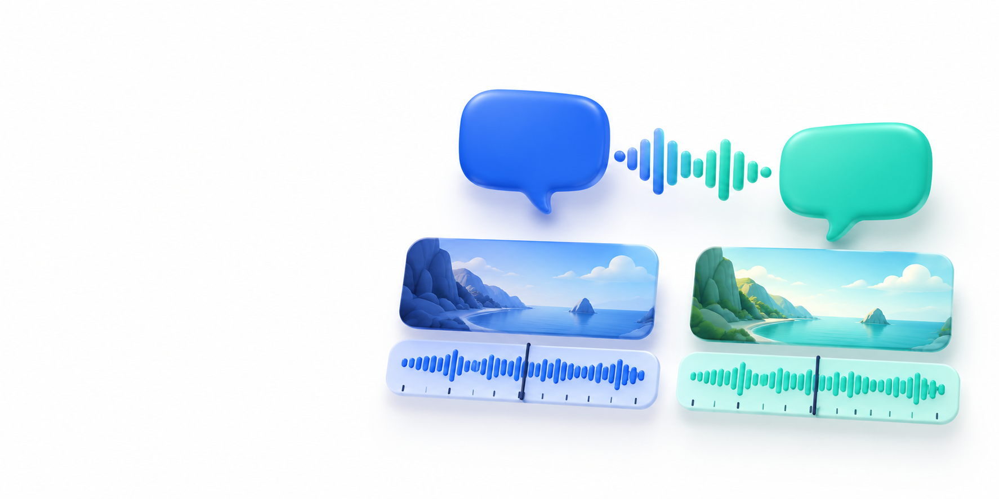

# OpenDub Studio

Experimental local-first AI video dubbing with speaker review, Hindi dubbing, resumable jobs and optional personal Kaggle processing.


**Experimental source alpha.** The MIT application code is provided without user recordings, voice references, rendered videos, transcript samples, training datasets or model weights. Review the setup guides and third-party model terms before processing your own media.

[Quick start](docs/QUICK_START.md) · [Model and asset terms](THIRD_PARTY_LICENSES/COMPONENTS.md) · [Release notes](docs/RELEASE_NOTES_ALPHA.md)

[FAQ](docs/FAQ.md) · [Demo details](docs/DEMO.md) · [Contributing](CONTRIBUTING.md) · [Security](SECURITY.md)

## Media and test data

No user recordings, voice references, rendered videos, transcript samples, training datasets or model weights are bundled in this repository. Automated tests are source code; do not add private recordings or generated exports as test fixtures. Use your own authorized inputs locally.

## Clone and run

Anyone can clone the public source repository and propose a contribution. Install Git, Python and FFmpeg/FFprobe first; see [installation and download requirements](docs/INSTALL.md).

Windows PowerShell:

```powershell
git clone https://github.com/Skbindas/OpenDub-Studio.git
Set-Location OpenDub-Studio
python -m venv .venv
.\.venv\Scripts\python.exe -m pip install -r requirements.txt
.\.venv\Scripts\python.exe scripts/check_dependencies.py
.\start.bat
```

Linux/macOS manual core path, after installing the system prerequisites:

```sh
git clone https://github.com/Skbindas/OpenDub-Studio.git
cd OpenDub-Studio
python3 -m venv .venv
.venv/bin/python -m pip install -r requirements.txt
.venv/bin/python scripts/check_dependencies.py
sh start.sh
```

Open the URL printed by the launcher (default http://127.0.0.1:7860), keep its terminal open and check **Setup & readiness**. These commands install the **core studio**, not every neural model. Optional-model compatibility and access must be resolved before a real dub.

| Choose your path | Guide |
| --- | --- |
| What must I download? | [Install / package and model inventory](docs/INSTALL.md) |
| Process on my computer | [Local packages, model downloads, voices and first dub](docs/LOCAL_SETUP.md) |
| Process with my Kaggle account | [Kaggle SDK, secure token, private inputs and execution](docs/KAGGLE_SETUP.md) |
| What happens after upload? | [Step-by-step UI workflow and troubleshooting](docs/QUICK_START.md) |
| What may I distribute or use commercially? | [Component terms](THIRD_PARTY_LICENSES/COMPONENTS.md) |
| What is the current software scope? | [Release notes](docs/RELEASE_NOTES_ALPHA.md) |

## Open contribution

Anyone may propose code, documentation, tests, translations, accessibility improvements or bug reports once the repository is public. See [how to contribute](CONTRIBUTING.md). The maintainer reviews changes, tests, security/privacy and licenses before merging; submitting a PR does not automatically merge it.

Created and maintained by **Suhaib · [@Skbindas](https://github.com/Skbindas)**, with **OpenAI Codex** AI-assisted development support. See [contributors and acknowledgments](CONTRIBUTORS.md) and [how maintainers review contributions](docs/MAINTAINER_REVIEW.md). GitHub's contributor graph reflects actual eligible commits; Codex is acknowledged as a tool.

**Simple workflow:** Upload video → choose language → review character voices → preview → export. Model/manual-stage settings live under Advanced. Local and Kaggle are explicit choices; cloud allocation is not guaranteed.

**Voice library:** A clean source checkout contains no bundled movie recordings or movie catalog. Import your own authorized references. Meera, Tara, Kabir and other legacy names are stable aliases when corresponding private entries exist; they are not a pack supplied to new users. Silent, mixed, invalid and unreviewed references must not become automatic defaults. Existing private evidence/audio is preserved outside source distribution.

**Licensing:** Our application code is MIT. OmniVoice's official model card distinguishes Apache-2.0 code from non-commercial pretrained weights. Check the pinned model terms and asset permissions before your use case; this repository does not grant rights to films or voice performances.

Removed projects retain their local files and project metadata in `runtime/deleted_projects` for recovery. Active processing must be stopped before removing a project. Archives contain local media and remain outside Git.

Local-first, open-source AI dubbing studio for video and movie localization.

> Experimental software. Review generated speech, timing, character assignments and separated backgrounds before delivery.

## Goals

- Run locally through a professional light-theme web studio.
- Persist projects and pipeline checkpoints across browser refreshes, server restarts, and machine restarts.
- Analyze long-form movies into scenes, dialogue segments, speakers, characters, timing and loudness metadata.
- Keep global character voice identity consistent across a full movie or series episode.
- Generate target-language dialogue, fit it to original timing, match loudness and mix it back with retained background audio.
- Support resumable/retryable jobs and safe cleanup of intermediate artifacts after successful final rendering.
- Keep AI/model components modular so local lightweight models can be used first and GPU/server workers can be added later.

## System Dependencies

OpenDub Studio requires the following external tools:

1. **FFmpeg & FFprobe:** Must be installed and available on `PATH`.
2. **Rubber Band (librubberband):** FFmpeg build with `--enable-librubberband` is strongly recommended for pitch- and formant-preserved dialogue time-stretching. If librubberband is not present in the FFmpeg build, OpenDub Studio safely falls back to standard `atempo` time-stretching.
3. **Environment Validation:** Run `python scripts/check_dependencies.py` to deterministically verify that all CLI executables, FFmpeg filters, and Python libraries are properly installed.

## Local-first design

The application is intended to run as:

`start.bat` → local backend → browser UI at `127.0.0.1`

The browser UI is the primary interface. CLI commands are provided for diagnostics, setup, automation and advanced workflows.

## License

This repository's application code is released under the MIT License. Third-party dependencies and model weights may have separate licenses; see `THIRD_PARTY_LICENSES/` and each upstream project's license terms before redistribution or commercial use.

## Durable workers

Long-running media and render jobs are persisted in SQLite and processed by a worker lease. Local `start.bat` uses an embedded worker by default. Server deployments can disable the embedded worker and run `python -m backend.worker` as a separate process. See `docs/DEPLOYMENT-SERVER.md` for the multi-worker and Docker profile.

## Launcher and local configuration

Use `start.bat` on Windows or `./start.sh` in a POSIX shell. The studio runs in the foreground and mirrors live output to `runtime/logs/studio.log`. Keep its terminal open. Ctrl+C asks for `yes` before an interactive shutdown; answering No keeps the server running. Reopening the launcher follows the existing instance's log. Closing that viewer does not stop the original instance.

The backend loads a local `.env` without overriding existing environment variables. Configure `HF_TOKEN` there for Community-1 speaker diarization. The token and project media are excluded from Git; credentials are read at execution time rather than stored in job payloads. Install optional translation, Piper, diarization and separation requirements for their respective stages.

Auto-dub executes real processing stages. Missing model access, unresolved timing, failed separation, clipping, or failed render QA stop automatic export. The default mix retains the estimated instrumental stem at unity gain, without background ducking or whole-mix loudness normalization. Neural stems still require listening review. Reopening dialogue review keeps saved lines; it does not rerun translation.

See the [first-run guide](docs/QUICK_START.md) for the actual UI workflow and troubleshooting.

## Brand artwork and your recordings



The illustration is conceptual brand artwork. This repository and its releases do not bundle user media or before-and-after video samples.

The [brand pack](web/brand/review.html) contains actual ImageGen sources, editable SVG adaptations, workflow icons and [generation prompts](web/brand/PROVENANCE.json). Open `/assets/brand/review.html` on your running localhost to review it. Exact image-model version was not exposed.

Use **Setup & readiness** for the local prerequisite checklist. **Voice library → Add your own recording** imports a private 3–10 second WAV reference with exact words and explicit source permission/listening confirmations. Imported references are not automatically generated or approved clones, and public distribution permission remains separate.
